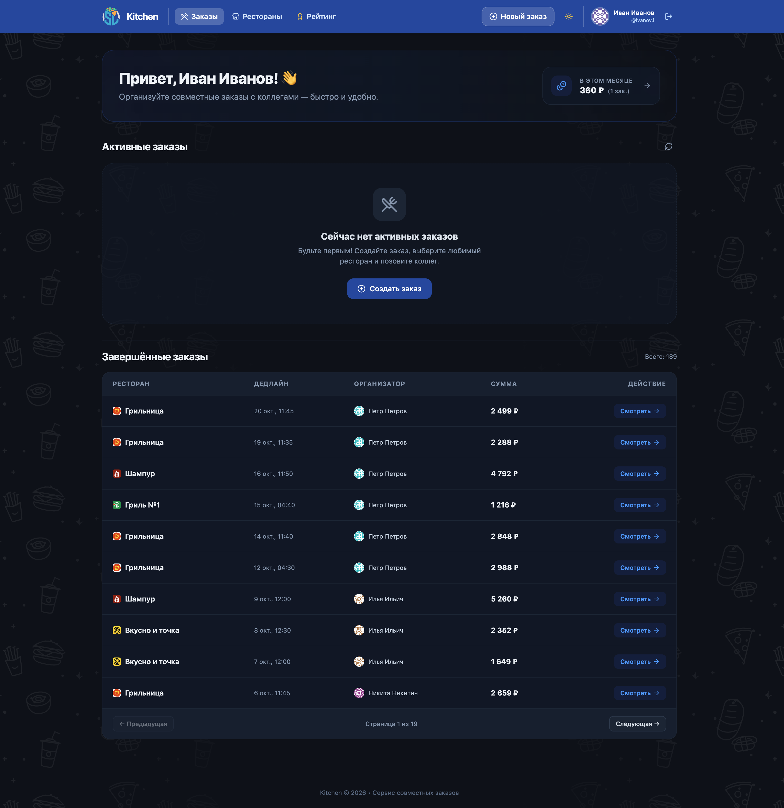

# 🍽️ Kitchen

<p align="center">
  
</p>

<p align="center">
  <a href="https://github.com/10almazoff10/kitchen/blob/main/LICENSE"></a>
  <a href="https://hub.docker.com/r/golovoshot/kitchen"></a>
  
  
  
  
  
</p>

---

**Kitchen** is a modern, self-hosted web application designed for **collaborative office and team food ordering**. It simplifies the daily routine of ordering lunches together: selecting a restaurant, gathering orders from colleagues, automatically splitting delivery costs, tracking payment statuses, rating meals, and sending scheduled Telegram notifications.

---

## ✨ Features

- 🍱 **Collaborative Orders**: Create collective food orders with custom order deadlines and comments.
- 🔗 **Automatic Menu Parsing**: Scrape restaurant menus directly from restaurant websites using JSoup (e.g. `shampur-brn.ru`).
- 💰 **Fair Cost Splitting**: Set delivery fees that are automatically distributed among participants proportionally.
- ✅ **Payment & Status Tracking**: Mark items as ordered at the restaurant and mark each user's payment status in real time.
- ⭐ **Ratings & Leaderboard**:
  - Rate dishes (1 to 5 stars).
  - Leaderboards: top spenders and most frequent food orderers (monthly and all-time).
- 🤖 **Telegram Bot Alerts**:
  - Instant alert when a new order is opened with direct link.
  - Warning notification 5 minutes before deadline.
  - Final notification when the order closes.
- 🔐 **Flexible Authentication**:
  - Out-of-the-box local development mode (auto-registration on first login).
  - Production-ready JWT token authentication.
  - **Active Directory / LDAP** integration with account linking.
- 🎨 **Modern SPA Interface**:
  - Responsive Vue 3 Single Page Application with Dark/Light theme support.
  - Avatars generated via Gravatar or custom fallbacks.

---

## 🛠️ Tech Stack

| Layer | Technologies |
|---|---|
| **Backend** | Java 17, Spring Boot 3.5, Spring Security, Spring Data JPA, Hibernate, JSoup, JJWT |
| **Frontend** | Vue 3 (Composition API, `<script setup lang="ts">`), Vite, Tailwind CSS v4, Pinia, Lucide Icons, Axios |
| **Database** | PostgreSQL 15+ |
| **DevOps & Deployment** | Docker, Docker Compose, Nginx |

---

## 🚀 Quick Start (Docker Compose)

You can launch Kitchen in seconds using the official pre-built Docker images:

### Option A: One-liner with `docker-compose.yml`

```bash
# 1. Download docker-compose.yml
curl -O https://raw.githubusercontent.com/10almazoff10/kitchen/main/docker-compose.yml

# 2. Start all services (Database, Backend, Frontend)
docker compose up -d
```

Open your browser at **[http://localhost](http://localhost)**.

> [!TIP]
> By default, the application runs in local mode (`LDAP_ENABLED=false`). You can sign in with **any username and password** — an account will be automatically initialized for you!

---

## ⚙️ Configuration (`.env`)

You can customize Kitchen by creating a `.env` file next to `docker-compose.yml`:

```bash
cp .env.example .env
```

| Variable | Default | Description |
|---|---|---|
| `FRONTEND_PORT` | `80` | Port for the Web UI (Nginx) |
| `BACKEND_PORT` | `8080` | Port for the Spring Boot REST API |
| `POSTGRES_USER` | `kitchen` | PostgreSQL database username |
| `POSTGRES_PASSWORD` | `kitchen_secret` | PostgreSQL database password |
| `POSTGRES_DB` | `kitchen` | PostgreSQL database name |
| `JWT_SECRET` | *(auto-generated)* | 256-bit+ secret key for JWT signing |
| `TG_BOT_TOKEN` | *(empty)* | Telegram Bot Token from [@BotFather](https://t.me/BotFather) |
| `TB_BOT_CHAT_ID` | *(empty)* | Telegram Chat/Channel ID for notifications |
| `LDAP_ENABLED` | `false` | Enable Active Directory / LDAP authentication |
| `LDAP_URL` | `ldap://localhost:389` | LDAP server URL (e.g. `ldap://ad.example.com:389`) |
| `LDAP_DOMAIN` | `example.com` | Corporate Active Directory domain |
| `LDAP_BASE_DN` | `DC=example,DC=com` | LDAP search base DN |
| `TZ` | `Asia/Barnaul` | Container timezone |

---

## 💻 Local Development

### 1. Prerequisites
- **JDK 17** or newer
- **Maven 3.9+**
- **Node.js 20+** & **npm**
- **Docker** (to run the PostgreSQL database)

### 2. Run Database
```bash
docker compose up -d db
```

### 3. Run Backend
```bash
mvn spring-boot:run
```
The REST API will be available at `http://localhost:8080`.

To run backend tests:
```bash
mvn test -q
```

### 4. Run Frontend
```bash
cd frontend
npm install
npm run dev
```
The Vite development server will start at `http://localhost:5173` with Hot Module Replacement (HMR).

---

## 📡 API Overview

The backend provides a clean RESTful API under `/api/v1/`:

- `POST /api/v1/auth/login` — Authenticate and retrieve JWT token
- `POST /api/v1/auth/link-ad` — Link Active Directory corporate credentials
- `GET /api/v1/orders` — List active and archived orders (paginated)
- `POST /api/v1/orders` — Create a new collaborative order
- `GET /api/v1/orders/{id}` — Order details with itemized list and cost summary
- `POST /api/v1/orders/{orderId}/items` — Add a dish/item to an order
- `PUT /api/v1/order-items/{itemId}/paid` — Toggle item payment status
- `GET /api/v1/restaurants` — List saved restaurants
- `POST /api/v1/restaurants/parse-menu` — Scrape restaurant menu by URL
- `GET /api/v1/ratings/leaderboard` — User ordering and spending leaderboard

---

## 🤝 Contributing

Contributions are warmly welcomed! Please read our [Contributing Guidelines](CONTRIBUTING.md) and [Code of Conduct](CODE_OF_CONDUCT.md) before submitting pull requests.

1. Fork the repo and create a feature branch (`git checkout -b feature/amazing-feature`).
2. Verify tests pass: `mvn test -q` and `npm run build`.
3. Commit your changes and open a Pull Request.

---

## 🔒 Security

For security vulnerabilities, please refer to our [Security Policy](SECURITY.md).

---

## 📄 License

This project is open-source software licensed under the [MIT License](LICENSE).

Developed with ❤️ by [Oleg Prokin](https://github.com/10almazoff10).
